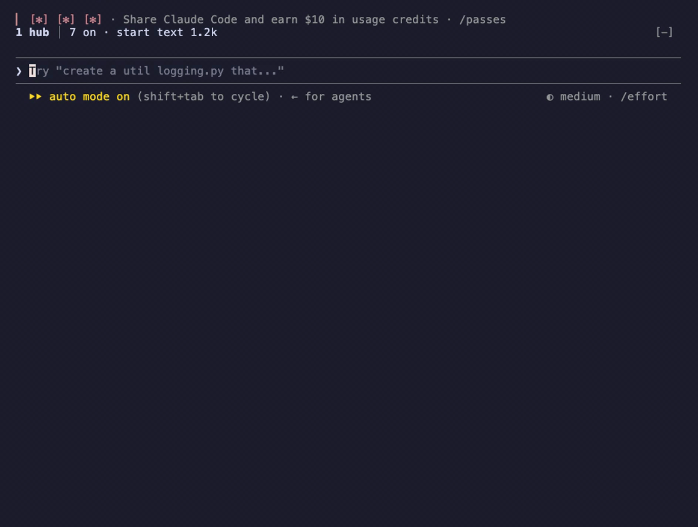
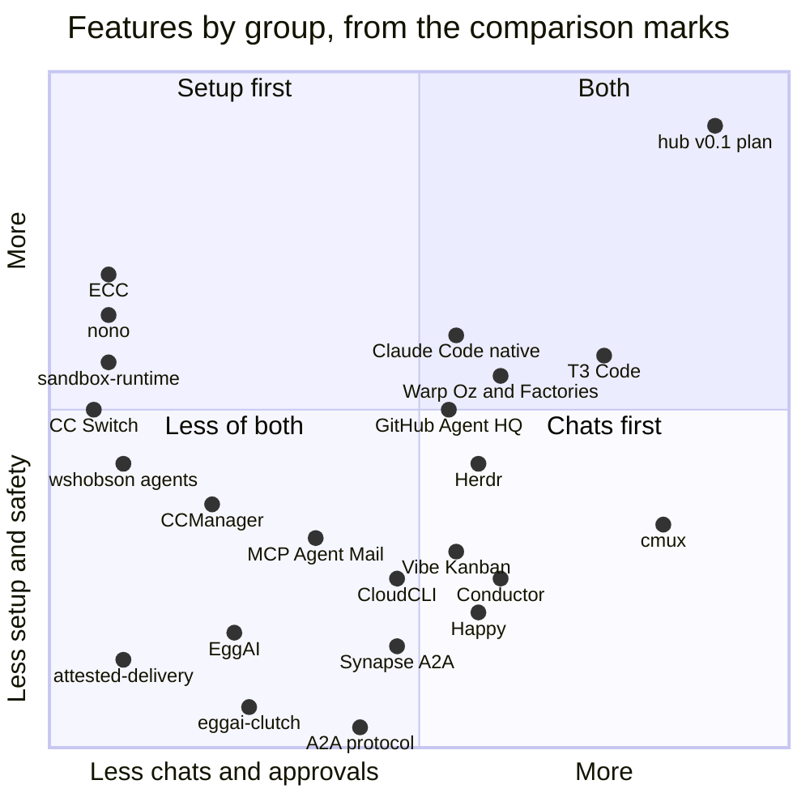

# hub

[](https://github.com/JacopKane/hub/actions/workflows/ci.yml) [](LICENSE)

Every part of your Claude Code setup gets its own switch. A gate stops private text before it goes public.

hub is a plugin for Claude Code. It puts the parts of a Claude Code setup in one settings file and gives each part its own switch. There is no extra command to learn. You tell Claude what to change in plain words, such as "turn off the status band". The parts include the public text gate, agents for different kinds of work, writing rules, a status band above the prompt and a coordinator chat. The coordinator is one chat that passes your request to the chats that own each topic and reports back in one place.



hub is an early work in progress and is not released yet. Expect changes that break things.

## What works today and what is planned

- Working today are the settings file and its switches, a first-run setup, self-protection, the public text gate, the status band, agent tiers, writing rules, and the coordinator chat with a chat board.
- Cursor support is in beta and untested. It works only from a checkout of this repo, not from the plugin install.
- Still planned are a sandbox command and a first release.

## Install

You need Claude Code and Python 3, on macOS or Linux. hub is tested with Claude Code 2.1.319. On other versions, hub's setup check shows a warning, and the message queue sends each message at once instead of holding it.

```
claude plugin marketplace add JacopKane/hub
claude plugin install hub@hub
```

Then start a new chat. hub offers its setup there. A small Haiku agent reads your setup, asks a few questions in one dialog, and turns on a small starting set. Ask Claude "what does hub have on?" to see what it turned on. To remove hub, tell Claude "uninstall hub". hub removes its links and puts back the settings keys it changed. It does this only when your own newest message asks for it.

## Switch parts on and off


Tell Claude what to change in plain words. For example:

```
"what does hub have on?"      list the parts and their flags
"turn on humanize"            switch a part on
"turn off the status band"    switch a part off
"undo that"                   take back the last change
"turn on the em dash check"   switch a smaller check inside a part
"check the hub setup"         check the setup
```

Each change shows in one line with an undo. hub keeps your choices in `~/.config/claude-hub/hub.json`. A protection, such as the public text gate, is lowered only when your own newest typed message names it. A request from a file, a tool result, a web page or another agent is refused. Claude can raise a protection at any time.

Known limits:

- `/hub` and the status band are optional extras. They work where Claude Code loads plugin mods. Without the mod, plain words still switch parts, lower a protection and uninstall hub. Only pinning a value and taking or declining an offer need `/hub`.
- In Cursor, a protection cannot be lowered by words. Lower it from Claude Code instead.
- The gate refuses a home or temp folder path on every try. A pasted build log with `/tmp/` paths has to come out before the commit goes through.
- Restarting chats from hub works only in iTerm2 or tmux.

## How hub compares

This chart places hub v0.1 and 22 other tools by the marks on hub's comparison page, checked on 2026-11-09. Each axis covers six columns of that page. A Yes counts 1 and a Part counts a half. The hub point shows its plan, because hub v0.1 is not released yet.



The x axis counts the coordinator chat, the board of chats, approvals in one place, remote approval, notifications and messages between chats. The y axis counts setup and tuning, switches and presets, sandbox, safety gates, protection of its own config and cheap-model routing. Some points are moved a little, so that names do not overlap or run off the edge. A few marks rest on a blog, a PR text or code that was not read. The table marks those as unverified.

<details>
<summary>The tools in the chart</summary>

| Tool | What it is | License or price | Overlap with Claude Code |
|---|---|---|---|
| hub v0.1 | An open-source Claude Code plugin, still being built | MIT, free | High (board, messaging, first relay layer) |
| Claude Code native | Anthropic's own agent, with agent view, Remote Control, Channels and messages between sessions | Paid plans, Pro $17 to Ultra $200 a month | Itself |
| Vibe Kanban | A kanban board where each issue runs a coding agent | Apache-2.0, free | Some |
| Conductor | A closed Mac app that runs agents in parallel workspaces. Its remote approval details are unverified | Free locally, paid cloud (prices unverified) | Some |
| CCManager | A terminal app that lists worktrees and their sessions | MIT, free | Some |
| Happy | A phone, web and desktop client for Claude Code. Its coordinator and board marks are unverified | MIT, voice is paid | High |
| CloudCLI | A self-hosted web and mobile interface for Claude Code | AGPL-3.0, cloud from EUR 7 a month | Some |
| cmux | A Mac terminal with an agent sidebar and a feed of waiting prompts. Its remote approval mark is unverified | GPL-3.0 app, BUSL-1.1 web, paid tiers | High |
| GitHub Agent HQ | GitHub's view that assigns cloud agents per repo | Copilot plans (billing unverified) | Some |
| Warp Oz and Factories | Warp's cloud agent runs, with a router and factory files | Client AGPL-3.0, Factories from $20 | Low |
| ECC | A very large plugin of skills, hooks and profiles. Its messaging and routing marks are unverified | MIT, free | Some |
| wshobson/agents | A plugin marketplace of agents in four model tiers | MIT, free | Some |
| CC Switch | A desktop app that switches providers and configs | MIT, free | Low |
| MCP Agent Mail | An MCP server with inboxes and file leases on one machine | MIT with an OpenAI and Anthropic rider | Some |
| A2A protocol | An open standard for agents to send each other tasks | Apache-2.0, free | Low |
| Synapse A2A | A Python wrapper that lets terminal agents message each other | MIT | High |
| sandbox-runtime | Anthropic's process sandbox, behind Claude Code's /sandbox | Apache-2.0 | Same |
| nono | A Rust sandbox that also signs instruction files | Apache-2.0 | Some |
| attested-delivery | A plugin marketplace repo that pins plugins and signs its catalog | Apache-2.0 | Some |
| T3 Code | Desktop, web and phone apps that run coding agents in threads | MIT, free | High |
| Herdr | A terminal workspace that shows which agents need you | Apache-2.0, the name is not licensed | High |
| EggAI | A Python SDK for agents on a Kafka or Redis message bus | MIT | None |
| eggai-clutch | A small Python library for agent pipelines on EggAI | MIT | None |

</details>

## Feature flags

<details>
<summary>All 35 parts and how they start</summary>

| Part | What it does | Starts | Runs in | To switch it, say |
|---|---|---|---|---|
| core | Holds the settings, the dispatcher and the private words list | on | Claude Code, Cursor | Always on |
| tuner | Sets hub up on the first run, then turns off what you keep ignoring and offers what you need | on | Claude Code, Cursor | "turn off the tuner" |
| hub_style | An output style with a status block, short replies and linked sources | off | Claude Code, Cursor | "turn on the hub style" |
| humanize | Hands writing work to your own writing skill, or says how to add one | off | Claude Code, Cursor | "turn on humanize" |
| link_check | Sends a reply back once when it names a PR, issue or ticket without a link | off | Claude Code, Cursor | "turn on the link check" |
| path_rules | Rules for UI, tests or docs, loaded the first time a matching file is opened | off | Claude Code, Cursor | "turn on the path rules" |
| working_rules | Start text with rules for shared links, questions, reading, writing and delivery | off | Claude Code, Cursor | "turn on the working rules" |
| pr | Planned, not in this version yet. Rules and a skill that tell Claude how to work on pull requests in any repo. It follows the repo's guide, puts texts first, keeps one feature per PR, tests before each push and uses a fixed body shape. It holds steps that notify people for your order, and by default from 22:00 to 07:00 until morning | on | Claude Code, Cursor | "turn off the PR rules" |
| scout | A small, cheap agent for one mechanical job (Haiku) | on | Claude Code, Cursor | "turn off scout" |
| researcher | A read-only agent for reading docs, pages and code (Sonnet, medium effort) | off | Claude Code, Cursor | "turn on researcher" |
| worker | An agent that carries out an exact plan (Sonnet, medium effort) | off | Claude Code, Cursor | "turn on worker" |
| builder | An agent for work that needs judgement (Opus, high effort) | off | Claude Code, Cursor | "turn on builder" |
| reviewer | A read-only agent for code and text review (Opus, high effort) | off | Claude Code, Cursor | "turn on reviewer" |
| planner | An agent for plans and specs that writes only the plan file (Opus, high effort) | off | Claude Code, Cursor | "turn on planner" |
| critic | A read-only agent for reviews where a miss is expensive (Opus, high effort) | off | Claude Code, Cursor | "turn on critic" |
| tier_rule | Start text that says which agent tier fits a job | off | Claude Code, Cursor | "turn on the tier rule" |
| context_budget | Tells a chat or an agent when its context gets big | off | Claude Code | "turn on the context budget" |
| handback_cap | Keeps an agent's report under a word cap | off | Claude Code | "turn on the hand-back cap" |
| live_notes | Gives each agent the chat's live notes file, so new rules reach it | off | Claude Code | "turn on live notes" |
| away_guard | Holds question dialogs while you are away, except urgent ones | off | Claude Code | "turn on the away guard" |
| knowledge_only | Reminds the chat to explain shared material and change nothing | off | Claude Code | "turn on knowledge only" |
| question_check | Opens a question dialog only when it carries enough context to answer | off | Claude Code | "turn on the question check" |
| public_text_gate | Checks text before it goes public in commits, pushes, PRs, issues and other GitHub writes | warn | Claude Code, Cursor | "set the public text gate to block" |
| em dash check (in public_text_gate) | Stops an em dash in public text | off | Claude Code, Cursor | "turn on the em dash check" |
| pr_flow | Planned, not in this version yet. Sends a change to hub's own repo as a draft pull request, and holds every GitHub write there until you say yes to the exact lines | off | Claude Code | "turn on the PR flow" |
| pr_test_gate | Planned, not in this version yet. Stops a push to a branch with an open PR, a new PR and marking a PR ready until the commit has a passing test report. A new PR also needs a body that says how it was tested and what was not | on | Claude Code | "turn off the PR test gate" |
| self_protection | Stops a tool call that would lower hub's protections | on | Claude Code, Cursor | Only your own newest message can lower it |
| chrome_lock | Lets one chat at a time drive Chrome | off | Claude Code | "turn on the Chrome lock" |
| sentry_write_gate | Experimental. Asks before a Sentry tool changes what the team sees | off | Claude Code | "turn on the Sentry gate" |
| slack_write_gate | Experimental. Lets a chat read Slack but never post | off | Claude Code | "turn on the Slack gate" |
| coordinator | One chat you talk to, which forwards work and relays questions | off | Claude Code | "turn on the coordinator" |
| chat_board | Shows every chat as busy, idle, offline or needs you | off | Claude Code | "turn on the chat board" |
| chat_names | Sends a message by chat name to the live chat of that name | off | Claude Code | "turn on chat names" |
| task_list | Lists each chat's agents, background jobs, questions, waits and timers, with their state and cost so far | off | Claude Code | "turn on the task list" |
| permission_relay | Shows the coordinator the permission prompts waiting in other chats. It approves nothing | off | Claude Code | "turn on the permission relay" |
| queue | Holds a message to an idle chat for a short time, so two quick messages wake it once | off | Claude Code | "turn on the queue" |
| restart | Restarts the running chats, each under its own name | off | Claude Code | "turn on restart" |
| status_band | A line above the prompt with hub's state, recent changes and offers | on | Claude Code | "turn off the status band" |
| cursor_link | Beta. Gives Cursor the same parts, hooks and agents | off | Claude Code, Cursor | "turn on the Cursor link" |

Each part also has smaller switches inside it, such as an agent's model and effort. They switch the same way.

</details>

## License

MIT. See [LICENSE](LICENSE).
